# Images 

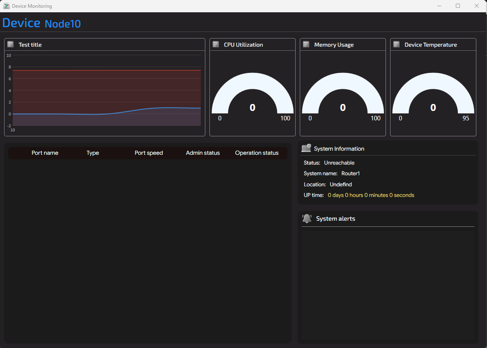

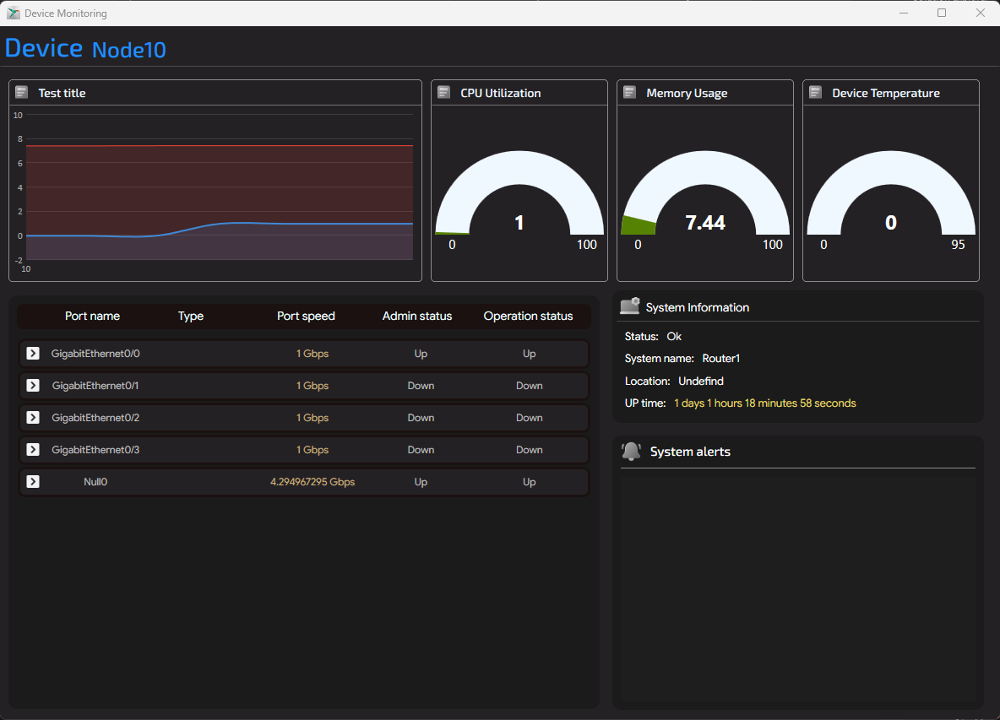

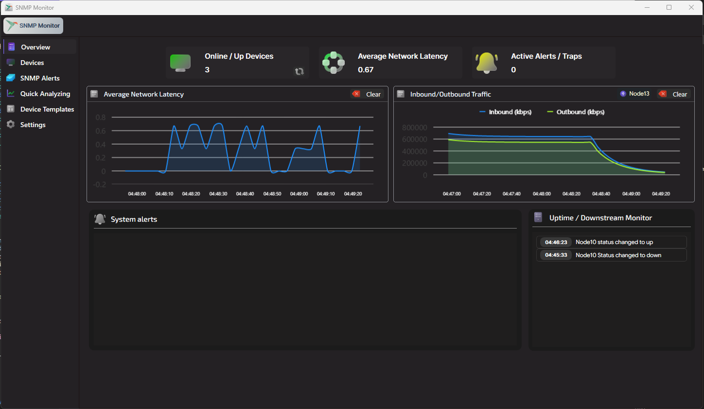

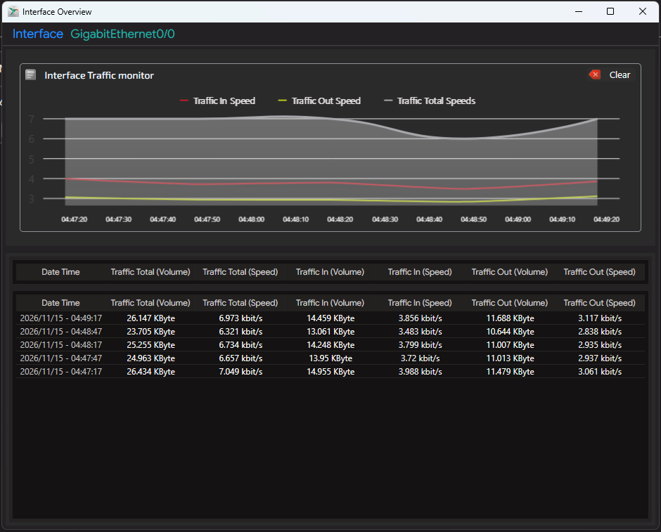

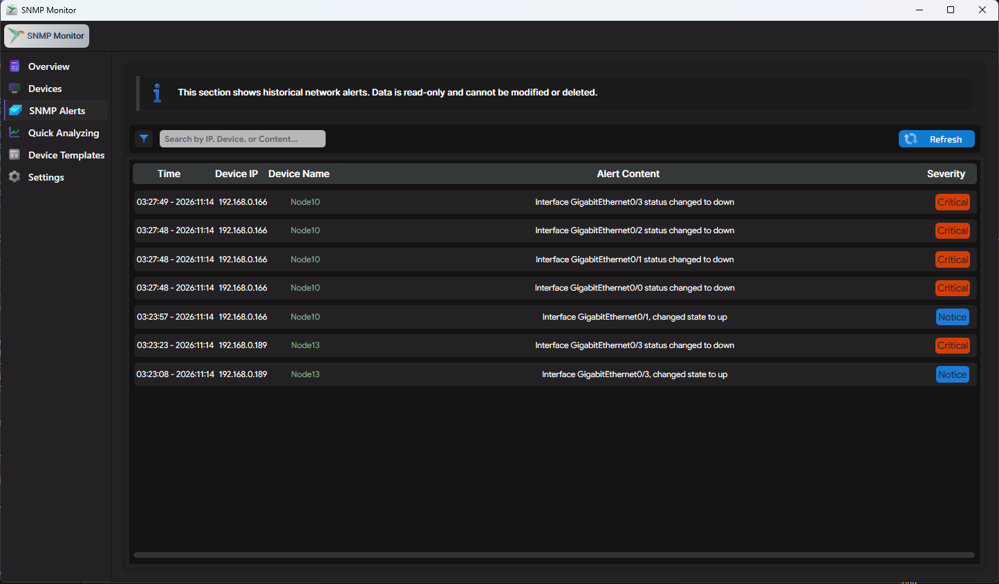

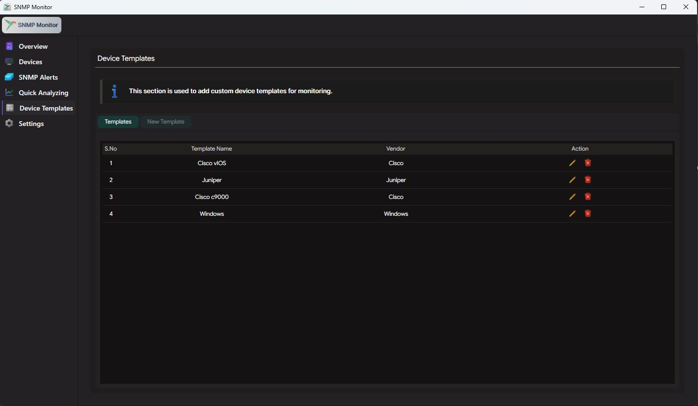

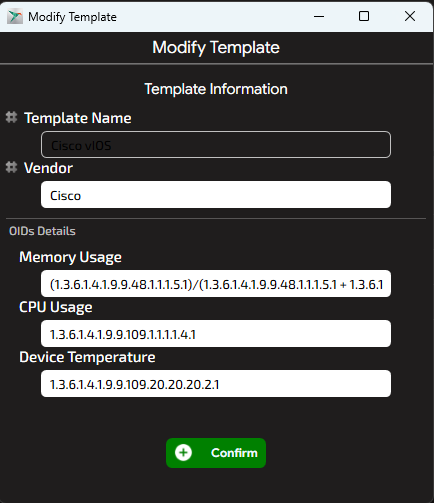

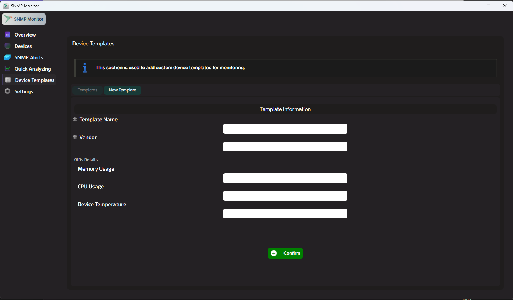

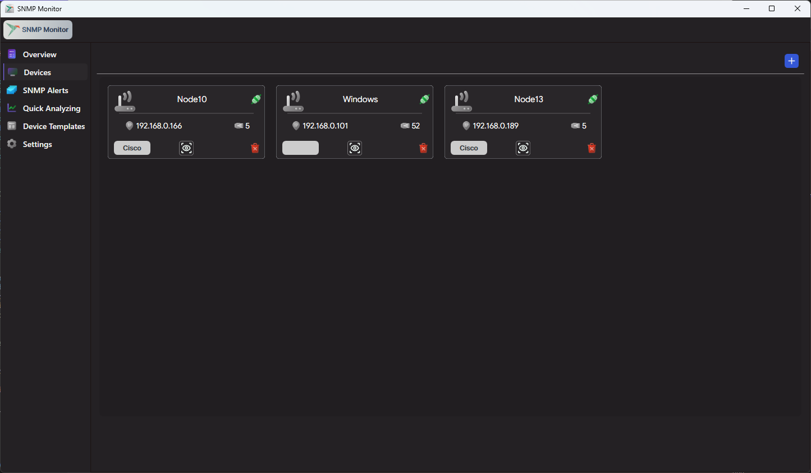

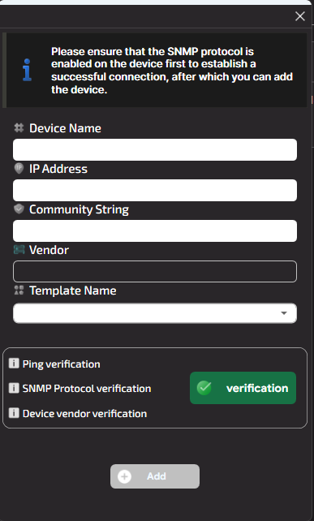

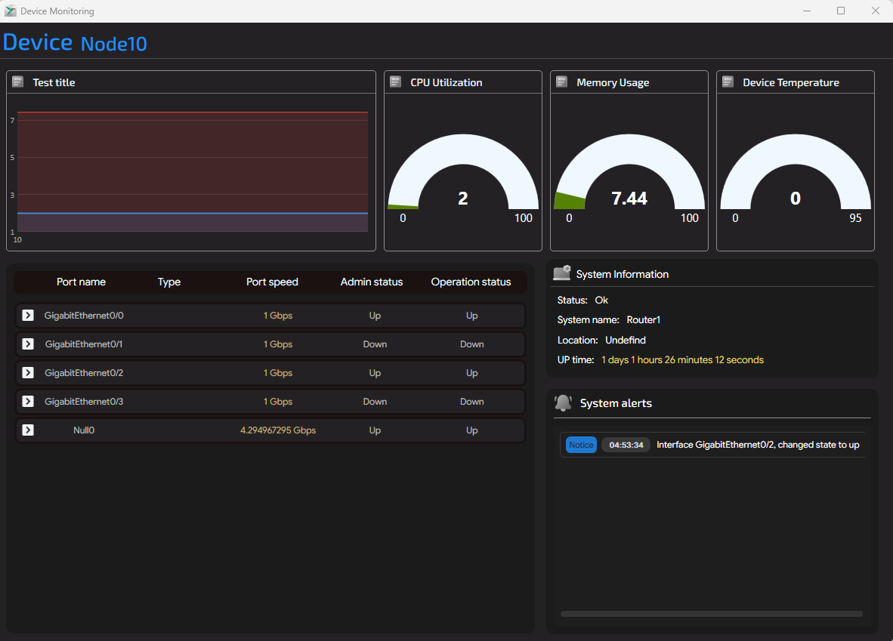

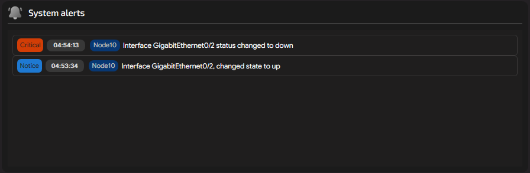

# SnmpMonitoring: Real-Time Network Management System (NMS)
Status: Under Active Development.

We are actively looking for contributors! If you are passionate about C#, WPF, and network management, feel free to check out the Contributing section below.

# Project Overview
SnmpMonitoring is a robust, evolving desktop application engineered for real-time network monitoring, device telemetry tracking, and infrastructure management. Built specifically for network administrators and operations teams, the system provides real-time visibility into enterprise networks by leveraging standard network protocols to poll metrics, analyze interface bandwidth performance, track device health, and capture asynchronous event notifications instantly.

# Tech Stack & Architecture
Framework & UI: C#, .NET, WPF (Windows Presentation Foundation)

Architectural Pattern: MVVM (Model-View-ViewModel) with Clean Architecture principles and modular service separation.

Network Protocols & Libraries:

SNMP (v2c / v3): Implemented via SharpSnmpLib for high-performance device polling and asynchronous SNMP Trap listening.

UDP Listener: Bound to port 162 for real-time background processing of incoming SNMP Traps.

Data Persistence: SQLite database managed via lightweight repositories for storing historical telemetry logs, device configurations, and alert histories.

Data Visualization & UI Components: LiveChartsCore with SkiaSharp integration for rendering smooth, real-time performance graphs, bandwidth utilization charts, and dynamic UI themes.

Asynchronous Processing: Advanced multi-threading and asynchronous task management (async/await) to ensure zero UI freezing during intensive network polling and background socket operations.

# Core Features & Functionalities
Real-Time Device Polling & Telemetry:

Automatically queries network devices (routers, switches, servers) at configurable polling intervals to retrieve system uptime, CPU/memory usage, and interface status.

Bandwidth & Traffic Analytics:

Calculates and visualizes interface throughput, packet error rates, and link utilization in real-time using dynamic charting components.

Asynchronous SNMP Trap Receiver:

Operates a background UDP listener on port 162 to capture unsolicited critical alerts, link-state changes, and device warnings instantly.

Interactive Dashboard & Visualization:

Features a clean, modern WPF dashboard built with MVVM architecture, offering custom device templates, status indicators, and live performance graphs.

Local Persistent Storage:

Stores historical metrics, event logs, and device inventories securely using SQLite, allowing operators to review past performance and incident histories.

Exception & Network Resiliency:

Implements robust fault-tolerance mechanisms to handle network timeouts, dropped packets, and unreachable hosts gracefully without destabilizing the application interface.

# Contributing
We welcome contributions from developers, network engineers, and open-source enthusiasts! Whether it's reporting a bug, improving documentation, or proposing new features, your help is greatly appreciated.
